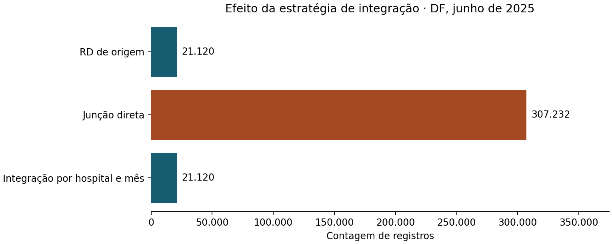
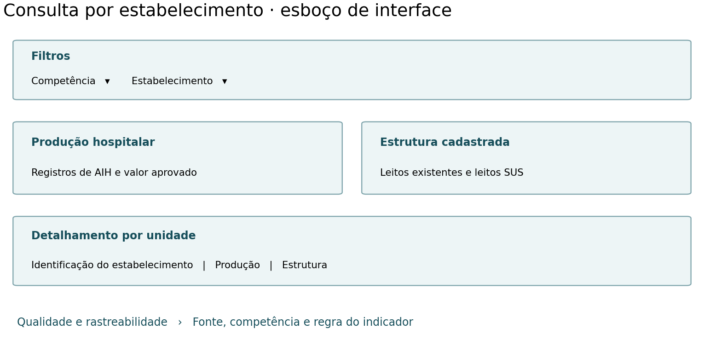

# Produção hospitalar e leitos cadastrados no SUS do Distrito Federal

TCC II de Sistemas de Informação · Centro Universitário do Distrito Federal (UDF) · Brasília  
Gabriel Silva dos Santos e Maurício Rafael Oliveira da Silva · Orientação de Kadidja Valéria Reginaldo de Oliveira  
Banca informada para 7 de dezembro de 2026.

**O que acontece com o total de AIHs quando cada registro de produção encontra várias categorias de leito no mesmo hospital?** O piloto de junho de 2025 compara a junção direta com a integração por estabelecimento e competência. O código, os critérios e os resultados agregados estão disponíveis para inspeção.

Fonte: elaboração a partir da [saída do piloto](evidencias/piloto.json). A barra da junção direta representa linhas produzidas pela operação incorreta. Na integração agregada, a medida é a soma das contagens de registros RD por estabelecimento.

## Percurso de leitura para a orientação

| Tempo sugerido | Leitura | Questão central |
|---|---|---|
| 15 min | [Delimitação e pauta de decisão](docs/escopo.md) | Qual problema se pode demonstrar? |
| 15 min | [Público, personas e requisitos](docs/personas.md) | Que documento sustenta cada tarefa e o que é hipótese? |
| 10 min | [Trabalhos aprovados e organização do texto](docs/trabalhos.md) | Onde entram requisitos, arquitetura e resultados? |
| 20 min | [Método e execução comentada](docs/execucao.md) | Como uma linha do RD chega a um indicador? |
| 10 min | [Código de integração](tccbi/core.py) e [evidência](evidencias/piloto.json) | Como detectar uma soma incorreta? |

## Interface proposta

Fonte: elaboração do projeto. Esboço de organização das consultas. O aplicativo executável está em [app.py](app.py). A distribuição do código inclui os testes e os manifestos. Os arquivos individuais de produção são processados localmente.
